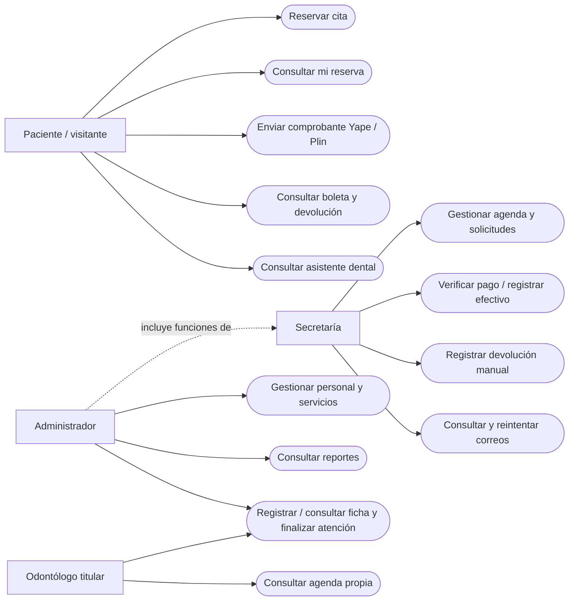

# Casos de uso — cierre de pendientes

El odontólogo registra y consulta únicamente fichas de sus citas. El administrador
puede hacerlo para cualquier cita. Secretaría no registra ni consulta el contenido
clínico de la nueva ficha. El paciente accede a su reserva con código y DNI; esa
autorización de sesión limita sus comprobantes y devoluciones. La administración
abarca las funciones de secretaría sin requerir otra cuenta.
